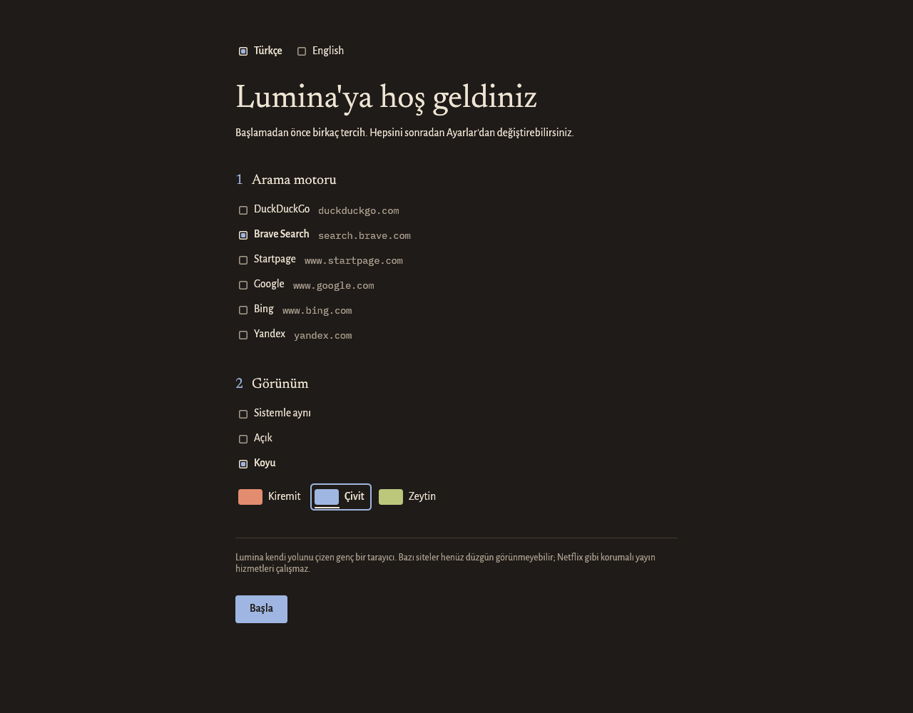

# Lumina

Lumina is a desktop web browser written entirely in Rust, built on the
[Servo](https://servo.org) web engine. It is not a fork or a reskin of
Chromium or Firefox, and it does not wrap a system WebView.

> **This is a ground-up rewrite.** Earlier versions of Lumina were a
> Tauri + Blazor application. That code is no longer developed; it is kept,
> with its full history, on the
> [`legacy/tauri-blazor`](https://github.com/GalaxySal/Lumina/tree/legacy/tauri-blazor)
> branch. Nothing on `main` descends from it.

## Status

Early, but real. What exists today:

- A native window that loads and displays real web pages through Servo.
- A toolbar with back, forward, reload and an address bar. Text that names a
  site is visited; anything else is searched for.
- Mouse, wheel and keyboard input, including input methods (IME) for
  languages that compose text.
- A first-run screen and a settings screen: search engine (DuckDuckGo by
  default; Brave Search, Startpage, Google, Bing or Yandex), start page,
  light/dark/system appearance, accent colour and language (Turkish or
  English). Choices apply at once and are kept in
  `~/.config/lumina/settings.toml`.



What does not exist yet: tabs, downloads, history, bookmarks, the ad blocker,
theme files, permission prompts and in-page pickers and dialogs. See
[CLAUDE.md](CLAUDE.md) (in Turkish) for the full list.

Two limits are worth knowing up front:

- **Site compatibility.** Servo is still maturing. Some sites render
  incorrectly or not at all.
- **DRM.** Services that require Widevine (Netflix, Spotify and similar) do
  not work. Widevine is licensed by Google and is not available to Lumina
  today.

## Building

Lumina currently targets Linux (Wayland and X11). You need a Rust toolchain
(installed automatically from `rust-toolchain.toml` by `rustup`), `clang`,
`python3` and `pkg-config`.

```
cargo run -p lumina                          # open your start page
cargo run -p lumina -- example.com           # open a site
cargo run -p lumina -- how do tides work     # search with your search engine
```

Shortcuts: Ctrl+L address bar, Ctrl+R or F5 reload, Alt+Left / Alt+Right
back / forward, Ctrl+, settings.

The first build compiles Servo and takes a long time.

```
cargo test --workspace
cargo clippy --workspace --all-targets -- -D warnings
```

## Principles

- One language: Rust, for the application, its tooling and its tests.
- No panics in shipped code; `unwrap`, `expect`, `panic!` and unchecked
  indexing are denied by lint.
- Private by default: no telemetry.
- Nothing is faked. A feature either works or is not shown.

## Licence

[Mozilla Public License 2.0](LICENSE). The bundled typefaces (Newsreader,
Alegreya Sans, IBM Plex Mono) are under the SIL Open Font License; their
licence texts are in [assets/fonts](assets/fonts).
